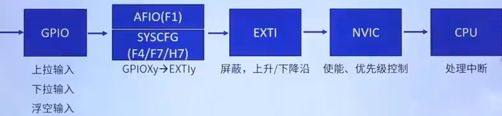
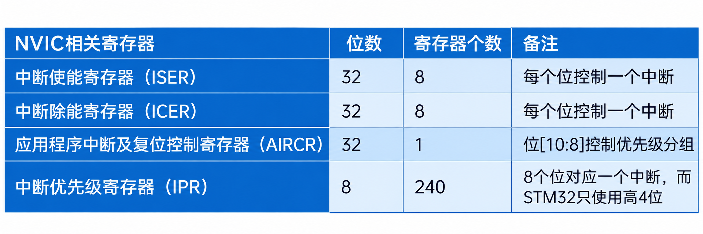
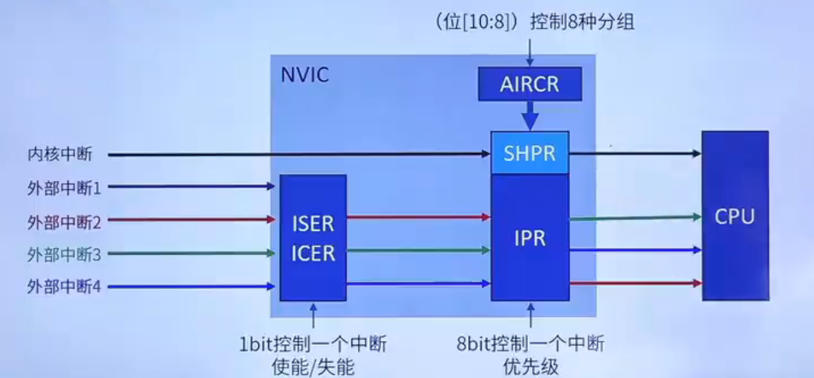

# 中断介绍
 **外部引脚中断线路图：**
 
 **AFIO** (复用功能输入输出控制器) :用于GPIO引脚映射到EXTI对应中断端口上

 **EXTI** (外部中断/事件控制器) :检测某个GPIO对应的外部信号有没有发生变化，然后产生中断请求

  **NVIC** (中断控制器) : 判断中断请求是否允许进入CPU,配置配置，配置中断优先级，多个中断同时发生时谁先执行

  **中断向量表** ：一块固定的内存区域，以四个字节对齐，用于存放**中断服务函数的首地址**，中断向量表定义在**启动文件中（__Vectors）**
***

# NVIC寄存器 



***
# NVIC配置
>注：以下函数调用所在文件位置: stm32f1xx_hal_cortex.c/h
>1. 配置中断分组 
>2. 设置中断优先级
>3. 使能中断

***  

### **HAL_NVIC_SetPriorityGrouping()**
1. **作用：** 配置中断优先级
2. **入参：** 
     - NVIC_PRIORITYGROUP_0 (0位抢占，4位子优)
     - NVIC_PRIORITYGROUP_2 (2位抢占，2位子优)
     - NVIC_PRIORITYGROUP_3 (3位抢占，1位子优)
     - NVIC_PRIORITYGROUP_4 (4位抢占，0位子优)
3. **代码示例**
    ```
    HAL_NVIC_SetPriorityGrouping(NVIC_PRIORITYGROUP_2);
    ```
*** 

### **HAL_NVIC_SetPriority()**
1. **作用：** 配置中断优先级
2. **入参：** 
     - (IRQn_Type): EXTI1_IRQn / RTC_IRQn / TIM1_IRQn ...  （中断号）
     - (uint32_t): 0~15 （抢占优先）
     - (uint32_t): 0~15 （子优先级）
3. **代码示例**
    ```
    //配置EXT1中断的抢占优先级为2，子优先级为2
    HAL_NVIC_SetPriority(EXTI1_IRQn,2,2); 
    ```
***

### **HAL_NVIC_EnableIRQ()**
1. **作用：** 使能中断
2. **入参：** 
     - (IRQn_Type): EXTI1_IRQn / RTC_IRQn / TIM1_IRQn ...  （中断号）
3. **代码示例**
    ```
    //使能EXTI1中断
    HAL_NVIC_EnableIRQ(EXTI1_IRQn); 
    ```
*** 

### **HAL_NVIC_DisableIRQ()()**
1. **作用：** 失能中断
2. **入参：** 
     - (IRQn_Type): EXTI1_IRQn / RTC_IRQn / TIM1_IRQn ...  （中断号）
3. **代码示例**
    ```
    //使能EXTI1中断
    HAL_NVIC_DisableIRQ(EXTI1_IRQn); 
    ```
*** 


