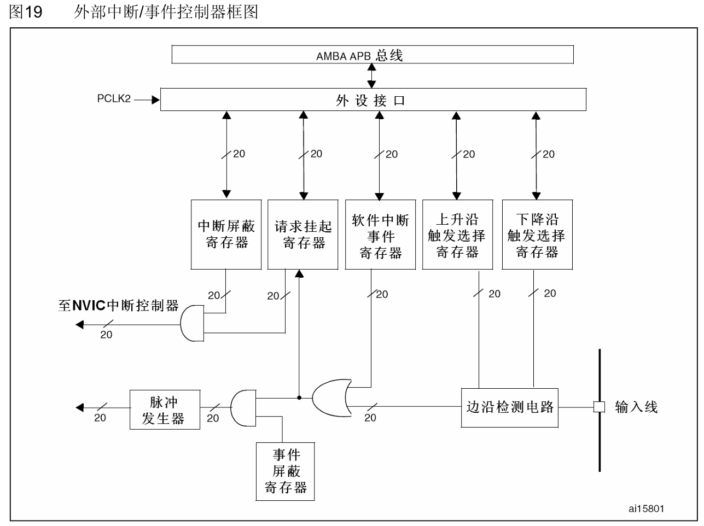

# EXTI介绍
 ### 外部(拓展)中断事件控制器件（EXTI）

**EXTI_RTSR**：上升沿触发选择寄存器

**EXTI_FTSR**：下降沿触发选择寄存器

**EXTI_SWIER**：软件中断事件寄存器

**EXTI_PR**：请求挂起寄存器

**EXTI_IMR**：中断屏蔽寄存器 

**EXTI_EMR**：事件屏蔽寄存器
>参考文档：数据手册-->9.2 外部中断/事件控制器(EXTI) 

 ### 外部中断线映射对应端口
 
如图例：PA0~PG0 共用EXTI0这一条线路，所以同一时间相同的引脚号只能使用其中一个引脚
***
# AFIO配置 EXTI配置
> 文件参考：STM32F10xx参考手册-->8.4.3~8.4.6

